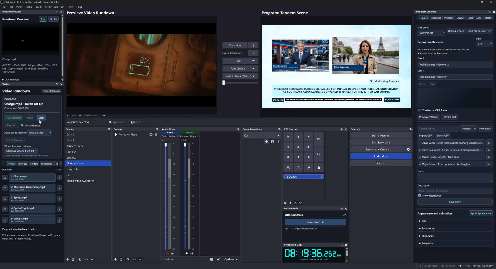

## Watch on YouTube

## Demo

# Support the project

# OBS Control Toolkit

OBS shortcut controls, PTZ camera tracking, Broadcast Graphics, and a Video Rundown with a media library, Cue and On Air previews, playback history, CSV reports, and JSON backups.

## Set up once

### Requirements

- **OBS Studio 31 or newer.** Open OBS once to create its settings, then exit it completely before installing the toolkit.
- **OBS WebSocket.** Use the server that comes with OBS. Video Rundown needs it to create or adopt its scene and control playback on Program.
- **Python.** The Windows x64 MSI bundles Python and its dependencies. The Windows folder-based setup checks for 64-bit Python 3.10 or newer with Tcl/Tk and can install it. For macOS, install Python 3.10 or newer for your Mac’s architecture before running setup. The folder-based setup downloads the Python packages it needs on the first run.

### Windows installer

1. Run `OBS-Control-Toolkit-1.6.1-x64.msi` while OBS is closed. If OBS is still running, setup asks you to exit it.
2. Finish the installer. It places the toolkit under `%LOCALAPPDATA%\OBS Control Toolkit\App` and registers its scripts and docks for your Windows user.
3. Reopen OBS and follow [Set up Video Rundown in OBS](#set-up-video-rundown-in-obs) below.

Use Windows **Settings → Apps → Installed apps** to uninstall while OBS is closed. A fresh MSI installation stores the rundown separately under `%LOCALAPPDATA%\OBS Control Toolkit\Rundown`. When migrating a working folder-based setup, the installer keeps using its existing `video-rundown` data folder, so keep that folder available. Uninstall leaves the library, backups and linked videos available. If installation fails, check `%LOCALAPPDATA%\OBS Control Toolkit\InstallerState\setup.log`.

To build the MSI, activate a Windows x64 Python 3.10+ environment with Tk and install `video-rundown/requirements.txt`. Obtain WiX 6 and the matching WiX UI and Util extensions, then run `python packaging/windows/build_msi.py --wix <wix.exe> --ui-extension <WixToolset.UI.wixext.dll> --util-extension <WixToolset.Util.wixext.dll> --out <output.msi> --work-dir <scratch-folder>`. Increment `--version` for a release that should upgrade an earlier MSI. Use `OBSCONFIG` with `msiexec` when registering a custom OBS profile. The build produces an unsigned MSI.

### Install from the toolkit folder

1. Extract the toolkit to a folder you plan to keep, such as Documents.
2. With OBS closed, run the setup command for your computer from the toolkit folder.

   | Computer | Setup file |
   | --- | --- |
   | Windows | `Setup-Windows.cmd` |
   | Mac | `bash ./Setup-Mac.command` in Terminal |

3. Follow the prompts. If setup offers to enable OBS WebSocket, choose **Yes** to enable it with password protection. If you use PTZ with AI tracking, enter your camera’s IPv4 address. Press Enter to skip camera setup or keep your current camera settings.
4. Reopen OBS and follow [Set up Video Rundown in OBS](#set-up-video-rundown-in-obs) below.

Setup adds **OBS Controls**, **Video Rundown**, **Rundown Preview**, **Production Clock**, and **Broadcast Graphics** to the Docks menu. It adds toolkit script registrations to existing scene collections and preserves other scripts and dock entries. An enabled OBS WebSocket keeps its current port, password, and authentication settings. If WebSocket already exists and is disabled, Setup asks before enabling it with password protection. The dock services start when OBS loads the toolkit script and stop when it unloads. You can close Setup after installation.

On macOS, the Lua runtime expects OBS at `/Applications/OBS.app`. Use an OBS build and Python distribution for your Mac’s architecture. Media drives and protected folders must be accessible to OBS and its Python helper. File and folder choices open the system picker directly. Windows uses the modern Explorer dialog and macOS uses its native file and folder dialogs.

Mac notification popups use the optional Xcode Command Line Tools. Install those tools and rerun Setup if you want the popups.

### Set up Video Rundown in OBS

1. Open **Tools → WebSocket Server Settings**. If **Enable WebSocket server** is off, turn it on, check **Enable Authentication**, then click **OK**. If the server is already on, keep its current settings.
2. Open **Docks → Video Rundown** and click **Set up scene**. Do this once for each scene collection you use. If the dock offers **Use existing scene**, confirm only if the scene and source are your intended rundown pair.
3. In **File Library**, link a video or folder and add a clip to **Playlist**. Put a scene containing the enabled **Rundown Player** on **Program** and click **Play selected**. The player can be inside an enabled group or nested scene.

If **Set up scene** reports “OBS or local storage is unavailable,” check that **Enable WebSocket server** is on and retry. Cue preview can play files while the WebSocket server is off.

## Broadcast Graphics

1. Turn on OBS WebSocket as described above, then open **Docks → Broadcast Graphics**.
2. Select a scene in OBS Preview, open a graphics tab, and click **Set up source**. With Studio Mode off, setup uses the current OBS scene. **Names** and **Custom** can each add several receivers per scene. Select a receiver before using Show or Hide. Use **Toolkit sources by scene** to control an existing receiver in a different scene.
3. Save and select an entry, then click **Show**. The **Clock** and **Date** tabs control independent sources and can use Show directly. **Crawler → Show** takes the saved crawl entries in order. Choose the blank, dot, or logo separator in **Appearance and animation**.
4. Choose **Manual Width**, **Fit to Text**, or **Fill Source** under **Appearance and animation → Background**. **Alignment** places the complete graphic inside the Browser Source. **Display Case** changes the rendered text while keeping the saved wording. Use **Preview entrance** and **Preview exit** to check animations away from Program, then select **Apply Appearance** to update the OBS output.

Drag the Broadcast Graphics tabs into your preferred order, or focus a tab and press **Alt+Left/Right**. The dock remembers the order.

Use **Import CSV** to review headers, compare them to the selected library’s example, and map fields before appending entries. In **Settings → CSV Libraries**, drop several CSVs to stage them. Check the destination and mapping for each file, then click **Import staged files**. Rows with blank main text are skipped. Each library has numbered, searchable, sortable entries and CSV export. **Settings → JSON Backup** handles the whole graphics library and its settings. Exports are saved to `graphics-exports` in the toolkit’s rundown data folder. Windows File Explorer or macOS Finder selects the saved file. The **Global Font Override** uses one installed font across graphics tabs while keeping their saved font selections.

### Custom graphics and colors

Use **Custom** for corner graphics such as **LIVE** or **FILE VIDEO** with an optional description or date. Add a receiver for each simultaneous label and select the intended receiver before clicking **Show**. Each entry can override its own colors, graphic and text alignment, animation, direction, and duration. Select a saved entry before adding a receiver to use its horizontal and vertical alignments for initial placement on the OBS canvas. You can fine-tune that position in OBS. **Settings → Fonts and Colors → Master color override for Custom** applies the Appearance palette across Custom entries. In **Names** and **Custom**, the description background can be colored or transparent.

Open **Color presets** from an entry or its Appearance panel to apply a palette. You can edit or rename a preset, or save it as a new preset. Recently saved and edited palettes appear first. Use **Copy HEX** beside any graphics color control to copy its value.

In **Names** and **Custom**, open **Appearance and animation → Background → Description background layout**. **Compact** keeps the background snug to the description. **Full-width band** adds a separate edge-to-edge strip below the main text. Use **Description background color** and **Transparent description background** to style the strip, then click **Apply Appearance**.

In **Custom**, open an entry’s **Default Source** section, choose a receiver, and click **Save entry**. Selecting the saved entry also selects that receiver automatically. **Show** requires the assigned receiver. Choose **Manual** and save if you want to select a receiver yourself. If you reassign an entry that has scheduled changes, update those schedules to match the new receiver. Default-source assignments are saved in the Broadcast Graphics JSON backup.

**Headlines** has a one- or two-line display, automatic numbering in the library, display-only case changes, and autoplay with an adjustable interval. The selected receiver shows **Autoplay running** or **Autoplay stopped**. The available Start or Stop button uses the accent color. The **Production Clock** dock still has its own **Display and formats** settings.

The toolkit stores entries and styles in `graphics.json`. It stores each receiver’s last content and visibility in `graphics-output.json` and restores them at startup. **Master Animation** controls what shows and animates when a scene goes to Program. Names and Program are enabled by default. A fresh MSI install uses `%LOCALAPPDATA%\OBS Control Toolkit\Rundown`. A folder-based or migrated setup uses its existing `video-rundown` data folder. Version 1.1.0 stored live content only in memory. Show each receiver once in the new version to establish its saved output state.

### Layout and previews

**Alignment** controls the graphic’s placement in the Browser Source and the text’s placement inside the graphic. Under **Background**, choose **All Sides** or set padding for each edge. Headlines use a fixed width and height during playback. Set both dimensions with **Manual Width**, or use **Fill Source**. The font size is the largest size used. Longer headlines shrink to fit the padded area and the selected one- or two-line layout. Previously saved **Fit to Text** headline styles switch to a fixed Manual Width box.

**Preview on OBS Scene** starts unchecked. Select an off-air receiver and check the box to inspect the draft at the receiver’s existing position and scale. In OBS Studio Mode, select that scene in Preview to see it. The draft is temporary and clears when disabled, when the dock closes, or when the receiver goes to Program. **Show** sends the saved entry.

### Scheduler

1. Select a saved entry in **Names**, **Program**, or **Custom**, open **Schedule**, and click **Add schedule**. Choose its OBS scene and receiver. Turn on **Enable Scheduler** in the Scheduler tab.
2. Choose **Clock** to use the OBS computer’s local date and time, with optional weekly, monthly, or yearly repetition. Due entries wait for approval. Click **✓** to show one or **×** to dismiss it. The approval queue survives a restart.
3. Choose **Video Rundown** to show an entry automatically when the next clip or a selected playlist item starts on Program. This one-shot trigger follows actual playback. If the receiver is unavailable on Program at that start, the Scheduler records the skip. A specific clip must still be in the playlist when saving or importing its schedule.

The **Scheduler** tab groups plans under collapsible Names, Program, and Custom sections. Search by entry, clip, scene, or receiver, and filter by graphics tab, trigger, and status. Use **Export CNN-style sample** for a versioned JSON template with fictional newsroom examples. Match the scene and receiver names to your OBS installation before importing. Imports validate the template, reuse matching graphics, and create missing entries.

## Using the toolkit

The **About** tab in Broadcast Graphics links to the GitHub source and issue tracker and to Ko-fi. You can report a bug, suggest an improvement, or fork the project and submit a pull request for a code or documentation change.

The Video Rundown and Broadcast Graphics docks show a small **Buy me a coffee** button from 10 a.m. to noon and from 2 p.m. to 4 p.m. on the OBS computer’s clock. Dismissing it hides it in both docks for that window. The button opens Ko-fi in your default browser.

- **Windows Ctrl + backtick** or **Mac Command + backtick** pauses or resumes shortcuts. The **OBS Controls** dock also has a toggle.
- **Windows Ctrl + 1** or **Mac Command + 1** toggles PTZ AI tracking when configured. The first press after loading requests On. Subsequent presses use the last camera-confirmed state.
- To change a camera's IP, port, or VISCA commands, open **Tools → Scripts** and select **fomako-tracking.lua**. The default commands are for tested in FoMaKo cameras. Other models may use different commands.
- The [Video Rundown guide](video-rundown/README.md) explains Cue, Program playback, and backups. The [hotkey guide](outputs/obs-hotkeys.html) shows the original TLMC bindings.

## Updating or moving the toolkit

Quit OBS and stop any old Video Rundown launcher before upgrading. To keep an existing library, playlist, history, and reports, preserve or copy the `video-rundown/video-cache` and `video-rundown/backups` folders into the updated toolkit before opening OBS. Run Setup again after updating the toolkit or creating a new scene collection. Before moving the toolkit, run Uninstall from its original folder, then run Setup at the new location. Setup reuses existing dock URLs and updates toolkit script settings only for its own script paths.

Setup stores backups of any changed OBS settings under `toolkit-setup-backups` in the OBS configuration folder. If a dock reports a connection error after startup, wait a moment and refresh it. If the error persists, open `tracking-runtime/toolkit.log` in the toolkit folder and check the OBS script log under **Tools → Scripts**. For a custom OBS configuration folder, pass `--obs-config` with its path to Setup. Use `--active-only` to register scripts only in the last active scene collection. In unattended setup, pass `--enable-websocket` to enable an existing disabled WebSocket configuration with password protection.

## Uninstall

Quit OBS completely. From the folder used for Setup, run **Uninstall-Windows.cmd** on Windows or `bash ./Uninstall-Mac.command` in macOS Terminal. From PowerShell or Terminal, preview the changes first if you wish.

- Windows PowerShell — `.\Uninstall-Windows.cmd --dry-run`
- macOS Terminal — `bash ./Uninstall-Mac.command --dry-run`

Uninstall removes the toolkit's script registrations and the docks identified by its installation record or earlier setup backups. It backs up the settings files it edits under `toolkit-setup-backups`. OBS scenes, media sources, profiles, other docks and scripts, and WebSocket settings stay in place. The toolkit folder, playlist, library, and media stay on disk.

If a dock from an older or manual install remains, use **Docks → Custom Browser Docks** to remove that entry. If you want to remove the **Video Rundown** scene or **Rundown Player** source, do so in OBS after checking where they are used. Uninstall uses an existing Python installation and runs without downloading dependencies.
