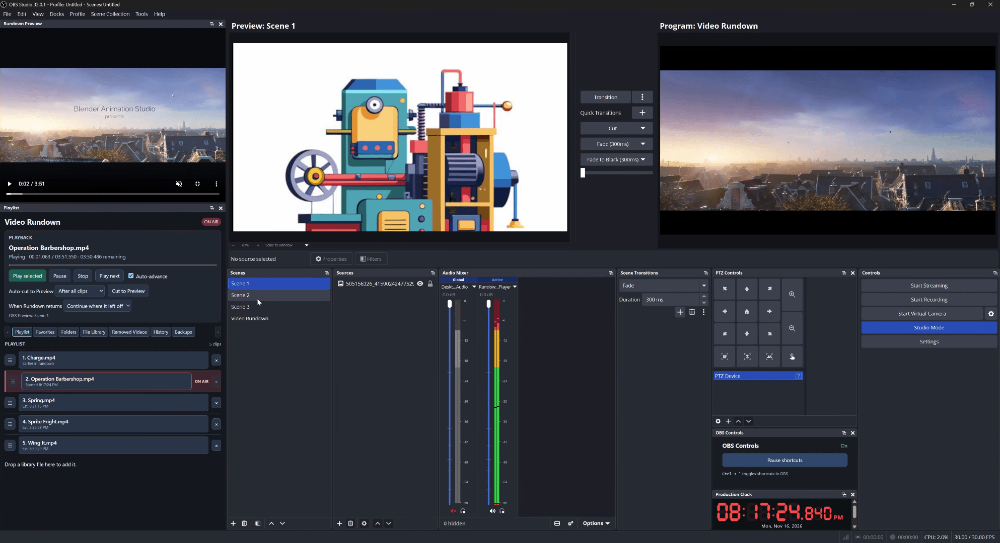

# OBS Control Toolkit

OBS shortcut controls, FoMaKo camera tracking, and a Video Rundown with a media library, Cue and On Air previews, playback history, CSV reports, and JSON backups.

## Set up once

### Requirements

- **OBS Studio 31 or newer.** Open OBS once to create its settings, then exit it completely before installing the toolkit.
- **OBS WebSocket.** Use the server that comes with OBS. Video Rundown needs it to create or adopt its scene and control playback on Program.
- **Python.** The Windows x64 MSI bundles Python and its dependencies. The Windows folder-based setup checks for 64-bit Python 3.10 or newer with Tcl/Tk and can install it. For macOS, install Python 3.10 or newer for your Mac’s architecture before running setup. The folder-based setup downloads the Python packages it needs on the first run.

### Windows installer

1. Run `OBS-Control-Toolkit-1.0.1-x64.msi` while OBS is closed. If OBS is still running, setup asks you to exit it.
2. Finish the installer. It places the toolkit under `%LOCALAPPDATA%\OBS Control Toolkit\App` and registers its scripts and docks for your Windows user.
3. Reopen OBS and follow [Set up Video Rundown in OBS](#set-up-video-rundown-in-obs) below.

Use Windows **Settings → Apps → Installed apps** to uninstall while OBS is closed. A fresh MSI installation stores the rundown separately under `%LOCALAPPDATA%\OBS Control Toolkit\Rundown`. When migrating a working folder-based setup, the installer keeps using its existing `video-rundown` data folder, so keep that folder available. Uninstall leaves the library, backups and linked videos available. If installation fails, check `%LOCALAPPDATA%\OBS Control Toolkit\InstallerState\setup.log`.

To build the MSI, activate a Windows x64 Python 3.10+ environment with Tk and install `video-rundown/requirements.txt`. Obtain WiX 6 and the matching WiX UI and Util extensions, then run `python packaging/windows/build_msi.py --wix <wix.exe> --ui-extension <WixToolset.UI.wixext.dll> --util-extension <WixToolset.Util.wixext.dll> --out <output.msi> --work-dir <scratch-folder>`. Increment `--version` for a release that should upgrade an earlier MSI. Use `OBSCONFIG` with `msiexec` when registering a custom OBS profile. The build produces an unsigned MSI.

### Install from the toolkit folder

1. Extract the toolkit to a folder you plan to keep, such as Documents.
2. With OBS closed, run the setup command for your computer from the toolkit folder.

   | Computer | Setup file |
   | --- | --- |
   | Windows | `Setup-Windows.cmd` |
   | Mac | `bash ./Setup-Mac.command` in Terminal |

3. Follow the prompts. If setup offers to enable OBS WebSocket, choose **Yes** to enable it with password protection. If you use FoMaKo tracking, enter your camera’s IPv4 address. Press Enter to skip camera setup or keep your current camera settings.
4. Reopen OBS and follow [Set up Video Rundown in OBS](#set-up-video-rundown-in-obs) below.

Setup adds **OBS Controls**, **Video Rundown**, **Rundown Preview**, and **Production Clock** to the Docks menu. It adds toolkit script registrations to existing scene collections and preserves other scripts and dock entries. An enabled OBS WebSocket keeps its current port, password, and authentication settings. If WebSocket already exists and is disabled, Setup asks before enabling it with password protection. The dock services start when OBS loads the toolkit script and stop when it unloads. You can close Setup after installation.

On macOS, the Lua runtime expects OBS at `/Applications/OBS.app`. Use an OBS build and Python distribution for your Mac’s architecture. Media drives and protected folders must be accessible to OBS and its Python helper. File and folder choices open the system picker directly. Windows uses the modern Explorer dialog and macOS uses its native file and folder dialogs.

Mac notification popups use the optional Xcode Command Line Tools. Install those tools and rerun Setup if you want the popups.

### Set up Video Rundown in OBS

1. Open **Tools → WebSocket Server Settings**. If **Enable WebSocket server** is off, turn it on, check **Enable Authentication**, then click **OK**. If the server is already on, keep its current settings.
2. Open **Docks → Video Rundown** and click **Set up scene**. Do this once for each scene collection you use. If the dock offers **Use existing scene**, confirm only if the scene and source are your intended rundown pair.
3. In **File Library**, link a video or folder and add a clip to **Playlist**. Put the **Video Rundown** scene on **Program** and click **Play selected**.

If **Set up scene** reports “OBS or local storage is unavailable,” check that **Enable WebSocket server** is on and retry. Cue preview can play files while the WebSocket server is off.

## Using the toolkit

- **Windows Ctrl + backtick** or **Mac Command + backtick** pauses or resumes shortcuts. The **OBS Controls** dock also has a toggle.
- **Windows Ctrl + 1** or **Mac Command + 1** toggles FoMaKo tracking when configured. The first press after loading requests On. Subsequent presses use the last camera-confirmed state.
- To change a camera's IP, port, or VISCA commands, open **Tools → Scripts** and select **fomako-tracking.lua**. The default commands are for FoMaKo cameras. Other models may use different commands.
- The [Video Rundown guide](video-rundown/README.md) explains Cue, Program playback, and backups. The [hotkey guide](outputs/obs-hotkeys.html) shows the original TLMC bindings.

## Updating or moving the toolkit

Quit OBS and stop any old Video Rundown launcher before upgrading. To keep an existing library, playlist, history, and reports, preserve or copy the `video-rundown/video-cache` and `video-rundown/backups` folders into the updated toolkit before opening OBS. Run Setup again after updating the toolkit or creating a new scene collection. Before moving the toolkit, run Uninstall from its original folder, then run Setup at the new location. Setup reuses existing dock URLs and updates toolkit script settings only for its own script paths.

Setup stores backups of any changed OBS settings under `toolkit-setup-backups` in the OBS configuration folder. If a dock reports a connection error after startup, wait a moment and refresh it. If the error persists, open `tracking-runtime/toolkit.log` in the toolkit folder and check the OBS script log under **Tools → Scripts**. For a custom OBS configuration folder, pass `--obs-config` with its path to Setup. Use `--active-only` to register scripts only in the last active scene collection. In unattended setup, pass `--enable-websocket` to enable an existing disabled WebSocket configuration with password protection.

## Uninstall

Quit OBS completely. From the folder used for Setup, run **Uninstall-Windows.cmd** on Windows or `bash ./Uninstall-Mac.command` in macOS Terminal. From PowerShell or Terminal, preview the changes first if you wish.

- Windows PowerShell — `.\Uninstall-Windows.cmd --dry-run`
- macOS Terminal — `bash ./Uninstall-Mac.command --dry-run`

Uninstall removes the toolkit's script registrations and the docks identified by its installation record or earlier setup backups. It backs up the settings files it edits under `toolkit-setup-backups`. OBS scenes, media sources, profiles, other docks and scripts, and WebSocket settings stay in place. The toolkit folder, playlist, library, and media stay on disk.

If a dock from an older or manual install remains, use **Docks → Custom Browser Docks** to remove that entry. If you want to remove the **Video Rundown** scene or **Rundown Player** source, do so in OBS after checking where they are used. Uninstall uses an existing Python installation and runs without downloading dependencies.
